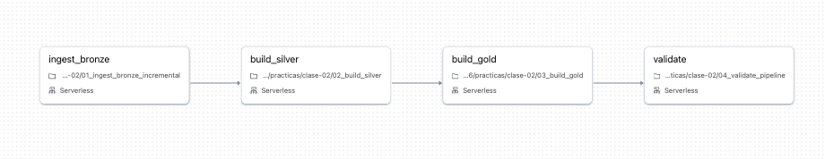
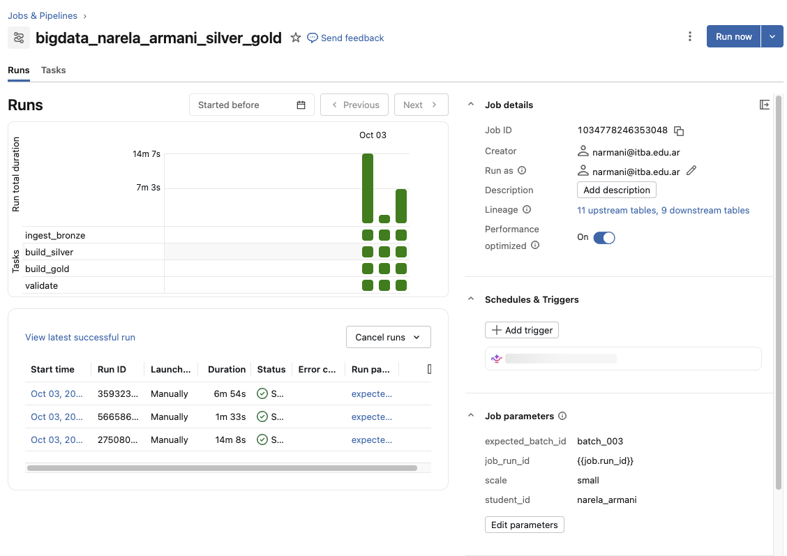
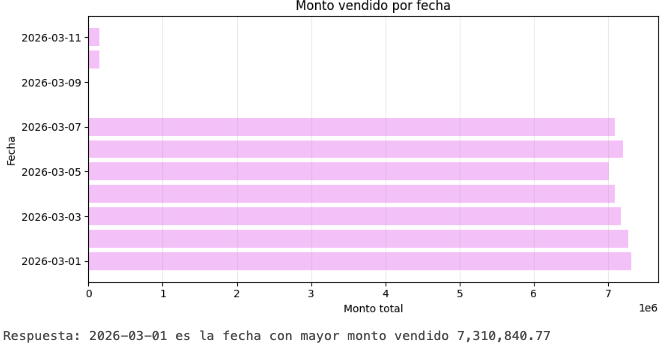
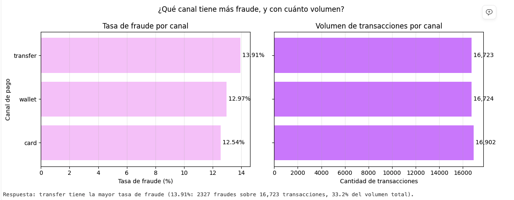
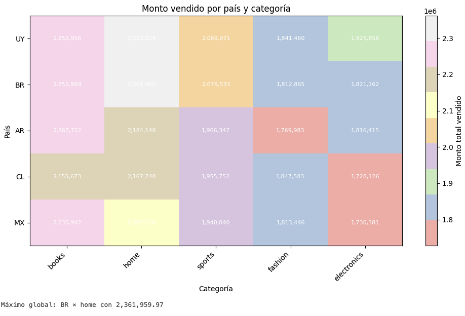
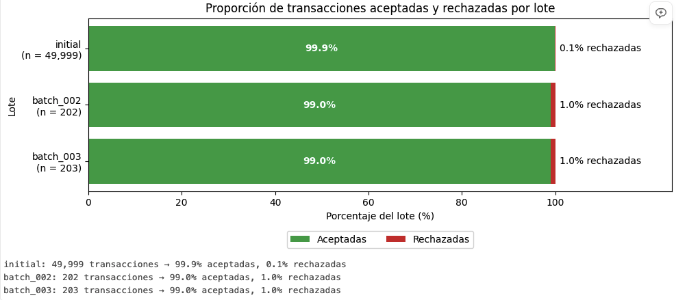

# Resolucion practica 2

Nombre: Narela Armani
student_id: narela_armani
Escala: small

## Job

https://dbc-c83455df-9a8a.cloud.databricks.com/jobs/1034778246353048?o=7474650272116762





## Ejecuciones

Los resultados de las ejecuciones se ven en la captura del job. Las metricas de la primera y la segunda corrida de batch_002 estan en la pregunta 10.

## COPY INTO y MERGE

COPY INTO evita cargar dos veces el mismo archivo en bronze. MERGE evita duplicar la misma transaccion en silver y aplica las correcciones, como la de la 42.

## Visualizaciones

### Consigna 1 - Evolucion temporal



El dia con mayor monto es 2026-03-01, con 7,310,840.77, y el dia con mas transacciones es el mismo. Como coinciden, el mayor monto se explica por la cantidad de transacciones y no hace falta un ticket promedio mas alto.

### Consigna 2 - Canal y fraude



El canal con mayor tasa de fraude es transfer, con 13.91% (2327 fraudes sobre 16723 transacciones). Le siguen wallet con 12.97% y card con 12.54%. La conclusion se sostiene porque los tres canales tienen casi el mismo volumen, cerca de un tercio cada uno, asi que la tasa mas alta de transfer no viene de tener mas transacciones.

### Consigna 3 - Pais y categoria



La combinacion con mayor monto es BR - home, con 2,361,959.97. No hay una categoria dominante en todos los paises: home lidera en BR, UY y CL, y books en AR y MX. Use un mapa de calor porque muestra todos los paises y categorias a la vez y se comparan facil.

### Consigna 4 - Calidad del pipeline



initial tiene 99.9% aceptadas y 0.1% rechazadas, sobre 49999 transacciones. batch_002 y batch_003 tienen 99.0% aceptadas y 1.0% rechazadas, sobre 202 y 203 transacciones. Los lotes nuevos tienen una tasa de rechazo 10 veces mas alta que initial.

La limitacion es que los lotes nuevos son muy chicos, con solo 2 rechazos ya llegan al 1%. Ademas esos 2 los mete el generador a proposito, asi que no muestran la calidad real de un lote.

## Preguntas

### 1. ¿Cuantas filas fisicas recibio cada lote en bronze_transactions_incremental?

```python
from pyspark.sql import functions as F

incremental = qualified_table(config, "bronze_transactions_incremental")

record_count = (spark.table(incremental)
                .groupBy("source_batch_id")
                .agg(F.count("*").alias("count")))

display(record_count)
```

Cada batch recibio 204 filas.

### 2. Aceptadas y rechazadas por lote, reconciliado con gold_batch_summary

```python
accepted_by_source = (spark.table(acctransactions)
                      .groupBy("source_batch_id")
                      .agg(F.count("*").alias("accepted_transactions"))
                      .orderBy(F.when(F.col("source_batch_id") == "initial", 0).otherwise(1), "source_batch_id"))

display(accepted_by_source)

rejected_by_source = (spark.table(rejtransactions)
                      .groupBy("source_batch_id")
                      .agg(F.count("*").alias("rejected_transactions"))
                      .orderBy(F.when(F.col("source_batch_id") == "initial", 0).otherwise(1), "source_batch_id"))

display(rejected_by_source)

display(spark.table(batch))
```

```python
# Reconcile with Gold

# 1. Unir aceptadas y rechazadas en una sola tabla por lote
mine = (accepted_by_source
        .join(rejected_by_source, on="source_batch_id", how="outer")
        .select(
            "source_batch_id",
            F.coalesce("accepted_transactions", F.lit(0)).alias("my_accepted"),
            F.coalesce("rejected_transactions", F.lit(0)).alias("my_rejected"),
        ))

# 2. Leer Gold y renombrar sus columnas para no chocar con las mías
gold = (spark.table(batch)
        .select(
            "source_batch_id",
            F.col("accepted_transactions").alias("gold_accepted"),
            F.col("rejected_transactions").alias("gold_rejected"),
        ))

# 3. Unir ambas y comparar columna contra columna
reconciliation = (mine
    .join(gold, on="source_batch_id", how="outer")
    .withColumn("accepted_ok", F.col("my_accepted") == F.col("gold_accepted"))
    .withColumn("rejected_ok", F.col("my_rejected") == F.col("gold_rejected"))
    .orderBy(F.when(F.col("source_batch_id") == "initial", 0).otherwise(1),
             "source_batch_id"))

display(reconciliation)
```

En batch_002 y batch_003 hay 2 rechazadas por lote y el resto aceptadas. Los numeros coinciden con gold_batch_summary en todos los lotes, accepted_ok y rejected_ok dan true en todas las filas. Tiene sentido porque gold arma el resumen con las mismas dos tablas.

Aceptadas + rechazadas no da igual a las filas de la pregunta 1 porque el duplicado exacto se borra en silver antes de validar, y la 42 queda una sola vez en silver con el source_batch_id del ultimo lote que la corrigio.

### 3. Motivos de rechazo en la cuarentena por lote

```python
reasons = spark.table(rejtransactions).select("quality_reason").distinct()

display(reasons)

reasons_by_batch = (spark.table(rejtransactions)
                    .groupBy("source_batch_id", "quality_reason")
                    .count()
                    .orderBy("source_batch_id", "quality_reason"))

display(reasons_by_batch)
```

Aparecen dos motivos, INVALID_AMOUNT y UNKNOWN_CUSTOMER. En batch_002 y batch_003 hay 1 de cada uno. En initial solo aparece INVALID_AMOUNT, 51 registros en small.

Coinciden con lo que mete el generador.

### 4. Transaccion 42 desde bronze_transactions_all hasta silver_transactions

```python
bronze_42 =spark.table(bronze_all).filter(F.col("transaction_id") == 42)

display(bronze_42)

silver_42_acc =spark.table(acctransactions).filter(F.col("transaction_id") == 42)

display(silver_42_acc)

silver_42_rej =spark.table(rejtransactions).filter(F.col("transaction_id") == 42)

display(silver_42_rej)
```

Aparecen 3 versiones en bronze_all: initial, batch_002 y batch_003. En silver aceptadas hay 1 y en rejected ninguna.

La que quedo en silver es la de batch_003 (amount 1999.99 y device_corrected_42). Las columnas que lo justifican son updated_at y source_batch_id. La de initial tiene como updated_at su event_ts, que es entre el 1 y el 7 de marzo. La de batch_002 tiene 2026-03-10 02:00:00 y la de batch_003 2026-03-11 02:00:00.

En 02_build_silver.ipynb silver ordena las versiones de cada transaccion con row_number por updated_at de mayor a menor (y si empatan por source_batch_id) y se queda con la primera. Gana batch_003 porque tiene el updated_at mas nuevo. Ademas el MERGE solo actualiza si el updated_at que llega es mayor al que ya estaba.

### 5. ¿silver_transactions tiene una sola fila por transaction_id?

```python
verification = spark.table(acctransactions).groupBy("transaction_id").count().filter("count > 1").count() == 0


print(verification)
```

Da True, no hay ningun transaction_id con mas de una fila. Si la deduplicacion hubiera fallado daria False, porque habria al menos un transaction_id con count mayor a 1.

### 6. Tasa de rechazo por lote

```python
rejection_rate = (spark.table(batch)
                  .withColumn("rejection_rate",
                              F.col("rejected_transactions") / (F.col("accepted_transactions") + F.col("rejected_transactions")))
                  .select("source_batch_id", "accepted_transactions", "rejected_transactions", "rejection_rate")
                  .orderBy(F.when(F.col("source_batch_id") == "initial", 0).otherwise(1), "source_batch_id"))

display(rejection_rate)
```

Initial tiene mas rechazadas en cantidad pero la tasa mas baja, porque es mucho mas grande. Los batch nuevos tienen pocas filas y siempre traen 2 invalidas, entonces su tasa es mas alta.

No es correcto comparar solo las cantidades si los lotes son de distinto tamaño, porque un lote grande va a tener mas rechazos aunque su calidad sea mejor. Con la tasa se pueden comparar.

### 7. Dia con mayor monto y dia con mas transacciones

```python
daily_totals = (spark.table(daily)
                .groupBy("sale_date")
                .agg(F.sum("total_amount").alias("total_amount"),
                     F.sum("transaction_count").alias("transaction_count")))

display(daily_totals.orderBy(F.desc("total_amount")).limit(1))

display(daily_totals.orderBy(F.desc("transaction_count")).limit(1))
```

El dia con mayor monto es 2026-03-01 y el dia con mas transacciones es el mismo.

### 8. Canal de pago con mayor tasa global de fraude

```python
channel_fraud = (spark.table(daily)
                 .groupBy("payment_channel")
                 .agg(F.sum("fraud_transactions").alias("fraud_transactions"),
                      F.sum("transaction_count").alias("transaction_count"))
                 .withColumn("fraud_rate", F.col("fraud_transactions") / F.col("transaction_count"))
                 .orderBy(F.desc("fraud_rate")))

display(channel_fraud)
```

El canal con mayor tasa de fraude es transfer.

No se puede promediar fraud_rate directo porque cada fila de gold_daily_sales es un grupo (dia, pais, categoria y canal) con distinta cantidad de transacciones. El promedio le da el mismo peso a un grupo de 3 transacciones que a uno de 300. Sumando fraudes y transacciones cada transaccion pesa lo mismo.

### 9. Combinacion de pais y categoria con mayor monto

```python
from pyspark.sql.window import Window

country_category = (spark.table(daily)
                    .groupBy("country", "category")
                    .agg(F.sum("total_amount").alias("total_amount")))

display(country_category.orderBy(F.desc("total_amount")).limit(1))

leader_by_country = (country_category
                     .withColumn("rank", F.row_number().over(Window.partitionBy("country").orderBy(F.desc("total_amount"))))
                     .filter("rank = 1")
                     .orderBy("country"))

display(leader_by_country)
```

La combinacion con mayor monto es BR - home.

Para la lider de cada pais use una ventana por country ordenada por monto y me quede con la primera fila de cada pais con row_number.

### 10. Primeras dos filas de pipeline_run_audit (reejecucion de batch_002)

```python
display(spark.table(audit).filter(F.col("expected_batch_id") == "batch_002").orderBy("recorded_at").limit(2))
```

silver_rows, quarantine_rows, gold_rows y gold_total_amount son iguales en las dos filas, la segunda corrida no cambio nada. Lo que cambia es job_run_id y recorded_at porque son dos corridas distintas.

La columna que demuestra la comparacion es idempotence_compared. En la primera fila es false porque no habia una corrida anterior del mismo lote, y en la segunda es true porque 04_validate_pipeline encontro la anterior con el mismo expected_batch_id y comparo las metricas. Si no hubieran dado iguales el assert hacia fallar el job.

### 11. COPY INTO

01_ingest_bronze_incremental.ipynb, celda del COPY INTO.

Resuelve la carga incremental de archivos. Lee toda la carpeta incoming/transactions/ pero solo carga los archivos que no cargo antes, asi se puede correr muchas veces sin duplicar datos en bronze y sin decirle cual es el archivo nuevo.

Para saber cuales ya cargo, la tabla delta guarda que archivos fisicos ya proceso (por su ruta). Cuando se vuelve a correr, el csv de batch_002 ya figura como cargado y lo saltea.

### 12. UNION ALL en bronze_transactions_all

01_ingest_bronze_incremental.ipynb, celda que crea la vista. La deduplicacion esta en 02_build_silver.ipynb.

Bronze tiene que guardar todo como llego. Si la vista borrara duplicados se perderian versiones que despues se necesitan, como las 3 de la transaccion 42. Ademas UNION solo borra filas exactamente iguales, y los duplicados de negocio no son iguales (mismo transaction_id pero distinto amount o updated_at). UNION ALL tambien es mas barato porque no compara las filas.

Los duplicados de negocio se resuelven en silver, que es donde los datos ya estan tipados y se aplican las reglas. Ahi primero se borran los duplicados exactos y despues se elige la version mas nueva de cada transaccion. Asi bronze queda como historial completo y si cambia la regla se puede reprocesar.

### 13. source_batch_id='initial' y event_ts como updated_at

01_ingest_bronze_incremental.ipynb, celda que crea la vista.

La tabla de la practica 1 no tiene source_batch_id ni updated_at, entonces la vista las completa para poder unirla con los lotes nuevos. 'initial' marca de donde vino la fila, y event_ts es lo mas parecido a la fecha de esa version porque es cuando paso la transaccion.

Para la 42 esto importa porque la version initial tiene updated_at entre el 1 y el 7 de marzo y las correcciones tienen 10 y 11 de marzo. Como son mas nuevas, la correccion gana en el row_number y en el MERGE. Si la initial tuviera una fecha mas nueva la correccion se ignoraria.

### 14. try_cast vs cast

quality_rules.py, funcion add_transaction_types.

Con try_cast si el valor no se puede convertir devuelve NULL y sigue. Con cast normal (con modo ANSI, que es lo default en databricks) el N/A tira error y falla toda la tarea por un solo registro. Con el NULL la regla INVALID_AMOUNT lo detecta y lo manda a cuarentena, y el N/A original queda guardado en amount.

### 15. Un registro que viola mas de una regla

quality_rules.py, funcion add_quality_reason.

Las reglas estan encadenadas con when y se queda con la primera que se cumple. Si un registro viola varias, solo queda la primera y las otras no aparecen.

El orden importa porque primero van las reglas de tipo (ids, fecha, amount) y al final las de integridad (UNKNOWN_CUSTOMER y UNKNOWN_PRODUCT). Si un customer_id no es numerico tambien falla el join con los clientes, y si UNKNOWN_CUSTOMER estuviera primero lo marcaria como cliente desconocido cuando en realidad el id es invalido.

### 16. _record_key y row_number

02_build_silver.ipynb, celda donde se calcula record_key y latest.

_record_key usa coalesce: si transaction_id se puede pasar a numero la clave es ese id, y si no es un hash sha256 de todas las columnas originales juntas (con los NULL reemplazados por "<NULL>").

Despues row_number numera las filas de cada _record_key ordenadas por updated_at de mayor a menor (y si empatan por source_batch_id), y se queda con _rn = 1, o sea la version mas nueva.

El hash cubre los registros con transaction_id invalido. Sin el, todos tendrian clave NULL, quedarian en el mismo grupo y row_number se quedaria con uno solo. Con el hash cada registro invalido tiene su propia clave y llega a la cuarentena.

### 17. MERGE de silver_transactions

02_build_silver.ipynb, celda del MERGE INTO.

Compara por transaction_id. WHEN MATCHED AND s.updated_at > t.updated_at THEN UPDATE SET *: si la transaccion ya existe y la que llega es mas nueva, la reemplaza (es lo que pasa con la 42). Si es igual o mas vieja, como en una reejecucion, no hace nada.

WHEN NOT MATCHED THEN INSERT *: si la transaccion no existe la inserta, que es lo que pasa con las transacciones normales de cada lote.

### 18. Gold completo vs silver con MERGE

03_build_gold.ipynb (CREATE OR REPLACE TABLE) y 02_build_silver.ipynb (MERGE INTO).

Gold son agregaciones, y actualizarlas de a partes es complicado porque una correccion cambia un total que ya estaba calculado. Es mas simple recalcular todo desde silver.

Reconstruir completo: la ventaja es que es simple y siempre da lo mismo, la limitacion es que recalcula todo cada vez y cuesta mas a medida que crece silver.

MERGE: la ventaja es que solo toca las filas que cambian y permite aplicar correcciones, la limitacion es que es mas complejo y depende de que la clave y la condicion esten bien, si no puede duplicar filas o ignorar correcciones.

### 19. expected_batch_id

01_ingest_bronze_incremental.ipynb (COPY INTO) y 04_validate_pipeline.ipynb.

El pipeline tiene que funcionar sin saber que archivo va a llegar, como pasaria con un sistema externo. El que descubre batch_003 es el COPY INTO de la tarea de ingesta, que revisa toda la carpeta y carga lo que no cargo.

expected_batch_id se usa solo en 04_validate_pipeline para saber que lote validar: que llego a bronze y silver, que tiene rechazos, que aparece en gold y que la correccion de la 42 vino de ese lote. Tambien se usa para decidir si compara con la corrida anterior para la idempotencia.

### 20. Si falla build_silver

GUIA_CREAR_JOB.md, tareas y dependencias.

El job es un DAG lineal: ingest_bronze -> build_silver -> build_gold -> validate, cada tarea depende de la anterior. Si falla build_silver, build_gold y validate no se ejecutan y el job queda en rojo.

Asi gold no se arma con un silver a medio actualizar y se queda con la ultima version buena, y validate no registra en pipeline_run_audit una corrida que fallo.
