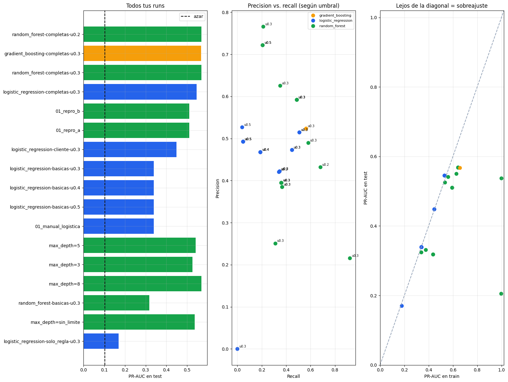

# Entrega práctica 5 — MLOps con MLflow

- **Nombre:** Narela Armani
- **student_id:** narela_armani
- **Escala:** small

## Mis runs

**Run registrado como `champion`:** `random_forest-completas-u0.3` (`random_forest`, `completas`, `n_estimators=100`, `max_depth=8`, umbral 0.3), registrado como `workspace.bigdata_narela_armani.fraud_model` versión 2.

| run | modelo | features | class_weight | umbral | hiperparametros | train_pr_auc | pr_auc | accuracy | precision | recall | f1 |
|---|---|---|---|---|---|---:|---:|---:|---:|---:|---:|
| `random_forest-completas-u0.3` | random_forest | completas | ninguno | 0.3 | n_estimators=100, max_depth=8 | 0.643 | 0.568 | 0.912 | 0.592 | 0.486 | 0.534 |
| `random_forest-completas-u0.2` | random_forest | completas | ninguno | 0.2 | n_estimators=100, max_depth=8 | 0.643 | 0.568 | 0.874 | 0.432 | 0.68 | 0.528 |
| `random_forest-completas-u0.3` | random_forest | completas | ninguno | 0.3 | n_estimators=100, max_depth=8 | 0.643 | 0.568 | 0.912 | 0.592 | 0.486 | 0.534 |
| `gradient_boosting-completas-u0.3` | gradient_boosting | completas | ninguno | 0.3 | max_depth=8, learning_rate=0.3 | 0.658 | 0.567 | 0.902 | 0.524 | 0.562 | 0.542 |
| `random_forest-completas-u0.3` | random_forest | completas | balanced | 0.3 | n_estimators=100, max_depth=8 | 0.629 | 0.55 | 0.645 | 0.216 | 0.923 | 0.35 |
| `logistic_regression-completas-u0.3` | logistic_regression | completas | ninguno | 0.3 | C=1.0 | 0.531 | 0.545 | 0.899 | 0.515 | 0.507 | 0.511 |
| `logistic_regression-completas-u0.3` | logistic_regression | completas | ninguno | 0.3 | C=1.0 | 0.531 | 0.545 | 0.899 | 0.515 | 0.507 | 0.511 |
| `01_repro_b` | random_forest | cliente | ninguno | 0.5 | n_estimators=100, max_depth=8 | 0.594 | 0.51 | 0.909 | 0.722 | 0.207 | 0.321 |
| `01_repro_a` | random_forest | cliente | ninguno | 0.5 | n_estimators=100, max_depth=8 | 0.594 | 0.51 | 0.909 | 0.722 | 0.207 | 0.321 |
| `logistic_regression-cliente-u0.3` | logistic_regression | cliente | ninguno | 0.3 | C=1.0 | 0.447 | 0.448 | 0.891 | 0.473 | 0.446 | 0.459 |
| `logistic_regression-cliente-u0.3` | logistic_regression | cliente | ninguno | 0.3 | C=1.0 | 0.447 | 0.448 | 0.891 | 0.473 | 0.446 | 0.459 |
| `logistic_regression-basicas-u0.3` | logistic_regression | basicas | ninguno | 0.3 | C=0.1 | 0.341 | 0.339 | 0.883 | 0.421 | 0.341 | 0.377 |
| `logistic_regression-basicas-u0.5` | logistic_regression | basicas | ninguno | 0.5 | C=0.1 | 0.341 | 0.339 | 0.897 | 0.527 | 0.039 | 0.073 |
| `logistic_regression-basicas-u0.3` | logistic_regression | basicas | ninguno | 0.3 | C=1.0 | 0.341 | 0.339 | 0.883 | 0.422 | 0.346 | 0.38 |
| `logistic_regression-basicas-u0.3` | logistic_regression | basicas | ninguno | 0.3 | C=1.0 | 0.341 | 0.339 | 0.883 | 0.422 | 0.346 | 0.38 |
| `logistic_regression-basicas-u0.4` | logistic_regression | basicas | ninguno | 0.4 | C=1.0 | 0.341 | 0.339 | 0.894 | 0.468 | 0.188 | 0.268 |
| `logistic_regression-basicas-u0.4` | logistic_regression | basicas | ninguno | 0.4 | C=1.0 | 0.341 | 0.339 | 0.894 | 0.468 | 0.188 | 0.268 |
| `logistic_regression-basicas-u0.5` | logistic_regression | basicas | ninguno | 0.5 | C=1.0 | 0.341 | 0.339 | 0.896 | 0.493 | 0.045 | 0.082 |
| `logistic_regression-basicas-u0.5` | logistic_regression | basicas | ninguno | 0.5 | C=1.0 | 0.341 | 0.339 | 0.896 | 0.493 | 0.045 | 0.082 |
| `logistic_regression-basicas-u0.4` | logistic_regression | basicas | ninguno | 0.4 | C=1.0 | 0.341 | 0.339 | 0.894 | 0.468 | 0.188 | 0.268 |
| `logistic_regression-basicas-u0.4` | logistic_regression | basicas | ninguno | 0.4 | C=1.0 | 0.341 | 0.339 | 0.894 | 0.468 | 0.188 | 0.268 |
| `logistic_regression-basicas-u0.5` | logistic_regression | basicas | ninguno | 0.5 | C=1.0 | 0.341 | 0.339 | 0.896 | 0.493 | 0.045 | 0.082 |
| `01_manual_logistica` | logistic_regression | basicas | ninguno | 0.5 | C=1.0 | 0.341 | 0.339 | 0.896 | 0.493 | 0.045 | 0.082 |
| `max_depth=5` | random_forest | basicas | ninguno | 0.3 | n_estimators=100, max_depth=5 | 0.377 | 0.331 | 0.876 | 0.395 | 0.359 | 0.376 |
| `max_depth=3` | random_forest | basicas | ninguno | 0.3 | n_estimators=100, max_depth=3 | 0.34 | 0.324 | 0.876 | 0.395 | 0.361 | 0.377 |
| `max_depth=8` | random_forest | basicas | ninguno | 0.3 | n_estimators=100, max_depth=8 | 0.437 | 0.318 | 0.873 | 0.385 | 0.365 | 0.374 |
| `random_forest-basicas-u0.3` | random_forest | basicas | ninguno | 0.3 | n_estimators=100, max_depth=8 | 0.437 | 0.318 | 0.873 | 0.385 | 0.365 | 0.374 |
| `max_depth=sin_limite` | random_forest | basicas | ninguno | 0.3 | n_estimators=100, max_depth=sin_limite | 0.998 | 0.205 | 0.832 | 0.251 | 0.311 | 0.277 |
| `logistic_regression-solo_regla-u0.3` | logistic_regression | solo_regla | ninguno | 0.3 | C=1.0 | 0.179 | 0.17 | 0.896 | 0 | 0 | 0 |

## Datos y tracking

**1.** train: 35,654 filas · test: 7,129 filas. Contracargos en test: 740 (10.4%).

Se separa por fecha ya que se entrena al modelo con datos del pasado, y se quiere predecir el futuro. Si se separara al azar, el modelo vería datos de días que después usamos para evaluarlo, y las métricas darían mejor de lo que realmente funciona.

**2.** Un modelo que siempre dice que no hay contracargo obtiene un accuracy de 89.6%, sin detectar ni un solo contracargo.

Se usa el PR-AUC porque hay muchas más transacciones legítimas que fraudulentas, por lo que un modelo con accuracy como métrica principal no tiene en cuenta esta diferencia. En cambio, el PR-AUC usa el área bajo la curva precision-recall para mirar qué tan bien encuentra los contracargos.

**3.** En el run `01_manual_logistica` quedó registrado:

- **Parámetros:** modelo `logistic_regression`, features `basicas`, `class_weight` ninguno, umbral 0.5, `C` = 1.0.
- **Métricas:** `pr_auc` 0.339, `train_pr_auc` 0.341, `roc_auc` 0.794, `accuracy` 0.896, `precision` 0.493, `recall` 0.045, `f1` 0.082.
- **Artefactos:** la matriz de confusión (`matriz_confusion.png`) y el modelo entrenado, con su firma y los requisitos de Python.

Un run es una ejecución de entrenamiento, con sus parámetros, métricas y artefactos. Un experimento es la carpeta que agrupa muchos runs para compararlos.

**4.** Autolog registró **46 parámetros** (todos los del Pipeline, por ejemplo `modelo__bootstrap`, `modelo__ccp_alpha`, `modelo__criterion`, `modelo__max_depth`) y estas métricas, todas de entrenamiento:

```text
training_accuracy_score: 0.91
training_f1_score:       0.887
training_log_loss:       0.229
training_precision_score: 0.901
training_recall_score:   0.91
training_roc_auc:        0.899
training_score:          0.91
```

Artefactos: `estimator.html`, `training_confusion_matrix.png`, `training_precision_recall_curve.png` y `training_roc_curve.png`.

Autolog no registra:

- Métricas sobre test. No sabe cuál es nuestro conjunto de test, así que no mide cómo anda con datos que no vio.
- El PR-AUC, que es nuestra métrica principal.
- El umbral y la versión de los datos (`threshold`, `data_version`), que son parámetros propios del problema.

**5.** Para que dos runs sean reproducibles, tienen que tener los mismos datos, mismo código, misma semilla y mismo entorno.

**6.** La firma sirve para declarar las columnas y tipos que espera el modelo y qué devuelve. Gracias a ella, si le pasan datos que no cumplen (como sin `amount`), MLflow lo frena antes de predecir.

## Tus experimentos

**7.** El mejor run fue `random_forest-completas-u0.3`, por las dos métricas:

| pr_auc | accuracy | precision | recall | f1 |
|---:|---:|---:|---:|---:|
| 0.568 | 0.912 | 0.592 | 0.486 | 0.534 |

Es un `random_forest` con las features `completas`, `n_estimators=100`, `max_depth=8`, umbral 0.3 y `class_weight` ninguno. Respecto de usar sólo `rule_alert` (`solo_regla`, PR-AUC 0.17), mejoró 0.398, más de tres veces.

**8.** Con `logistic_regression`, el PR-AUC pasó de 0.339 con `basicas` a 0.448 con `cliente` (+0.109) y a 0.545 con `completas` (+0.097). Agregar variables mejoró el modelo en cada paso. Las variables más importantes en mi mejor run (`random_forest` con `completas`) fueron `amount` (0.274), `payment_channel` (0.170) y `category` (0.054).

**9.** Con `completas`, el mejor fue `random_forest` (PR-AUC 0.568), casi empatado con `gradient_boosting` (0.567), y los dos superaron a la logística (0.545). Un modelo de árboles puede aprovechar combinaciones porque va haciendo preguntas en cadena (por ejemplo, primero si es de noche y después, dentro de esas, si es por transferencia), mientras que la logística le da un peso a cada variable por separado y los suma, sin ver cómo interactúan.

**10.** Con `class_weight = balanced`, el recall subió de 0.486 a 0.923, pero la precision bajó de 0.592 a 0.216: el modelo detecta casi todos los contracargos pero genera muchas más alertas falsas (de 608 alertas a 3,158). El PR-AUC casi no cambió (de 0.568 a 0.550), porque el modelo ordena el riesgo más o menos igual; lo que cambia es cuántas transacciones termina alertando.

**11.** Al bajar el umbral de 0.3 a 0.2, las alertas pasaron de 608 a 1,165: el recall subió de 0.486 a 0.680 y la precision bajó de 0.592 a 0.432. El F1 cambió un poco (de 0.534 a 0.528), pero el PR-AUC quedó igual (0.568). El PR-AUC no depende del umbral porque mide qué tan bien el modelo ordena las transacciones según su probabilidad, considerando todos los umbrales posibles; el umbral sólo decide dónde cortar. El F1, en cambio, se calcula con la precision y el recall de un umbral específico, así que cambia cuando lo movés.

**12.** Barrí `max_depth` en un `random_forest` con `completas`. El mejor PR-AUC de test fue con `max_depth=8` (0.568). Con `sin_limite`, el `train_pr_auc` llegó a 1.0 mientras que el de test bajó a 0.537: el modelo memorizó los datos de entrenamiento en lugar de aprender patrones que se repitan. Ese fenómeno se llama sobreajuste (*overfitting*).

## Comparar y elegir

**13.** Sí, coincidieron: `random_forest` con `completas` y umbral 0.3 fue el mejor tanto por PR-AUC (0.568) como por accuracy (0.912). Pero podrían no coincidir porque la accuracy premia no alertar: como sólo el 10% son contracargos, un modelo que casi no alerta acierta casi siempre. Por ejemplo, `solo_regla` no generó ninguna alerta y tuvo 0.896 de accuracy, mientras que con `balanced` la accuracy bajó a 0.645 aunque detectó el 92% de los contracargos. El PR-AUC, en cambio, mide qué tan bien el modelo encuentra los contracargos.

**14.** Los runs más lejos de la diagonal son los dos `random_forest` con `max_depth=sin_limite`: tienen PR-AUC de train cercano a 1.0, pero en test bajan a 0.537 (con `completas`) y 0.205 (con `basicas`). Eso indica sobreajuste: el modelo memorizó los datos de entrenamiento y no generaliza a datos nuevos. Las logísticas, en cambio, quedan sobre la diagonal, porque rinden parecido en train y en test.



**15.** La ventaja es que se pueden filtrar y ordenar los runs como cualquier tabla, sin tener que revisarlos uno por uno en la interfaz, y se puede automatizar (por ejemplo, para elegir el mejor modelo sin intervención manual).

```python
filter_string = f"tags.student_id = '{config.student_id}' AND params.model_type = 'random_forest' AND metrics.test_pr_auc > 0.55"
```

**16.** En general cuesta más un contracargo no detectado, porque la plataforma pierde el dinero de la compra, mientras que una alerta falsa sólo cuesta el tiempo de revisarla. Si el equipo puede revisar una cantidad fija de alertas por día, ajustaría el umbral para que la cantidad de alertas coincida con esa capacidad, así se revisan las transacciones más riesgosas. Por ejemplo, con umbral 0.3 se generaron 608 alertas y con 0.2, 1,165.

## Registro, uso y monitoreo

**17.** Sí, se pudo registrar como `workspace.bigdata_narela_armani.fraud_model`, versión 2, con alias `champion`. La ventaja de cargar `models:/...@champion` es que el código que usa el modelo no cambia: si encuentro un modelo mejor, registro una versión nueva y le muevo el alias `champion`. Con `runs:/<run_id>/model` tendría que cambiar el `run_id` en el código cada vez.

**18.** Transacciones puntuadas: 7,165 · alertas: 631 (8.8%).

Las columnas de `ml_predictions` que permiten auditar la decisión son las que están en el código: `transaction_id`, `score`, `alerta`, `threshold`, `model_name`, `model_version`, `run_id` y `scored_at`. El umbral se guarda afuera ya que se puede cambiar sin necesidad de reentrenar.

**19.** Sí, el PR-AUC sobre `nuevas` fue parecido al de test (0.554 contra 0.568), así que el modelo se mantuvo en producción. En la campaña simulada, el porcentaje de alertas pasó de 8.8% a 18.6%, más del doble. El drift es cuando los datos que llegan cambian respecto de los de entrenamiento por alguna influencia externa (como una campaña). Se puede detectar antes de tener las etiquetas porque se nota primero en las distribuciones de entrada y de scores, que se pueden monitorear en el momento, mientras que los contracargos tardan días en confirmarse.

## Cierre

**20.** Pasé por todo el ciclo: datos (armé `ml_features` con split temporal en el 00), entrenamiento y tracking (entrené distintos modelos y registré cada run en MLflow en el 01 y el 02, y los comparé en el 03), registro (registré el mejor en Unity Catalog con alias `champion`), despliegue (puntué las transacciones nuevas en batch) y monitoreo (comparé producción con test y simulé drift en el 04). Para producción real faltaría automatizar el scoring con un job programado, tener alertas automáticas si cambian las distribuciones o el % de alertas, y reentrenar periódicamente con datos recientes, validando el nuevo modelo antes de moverle el alias `champion`.
